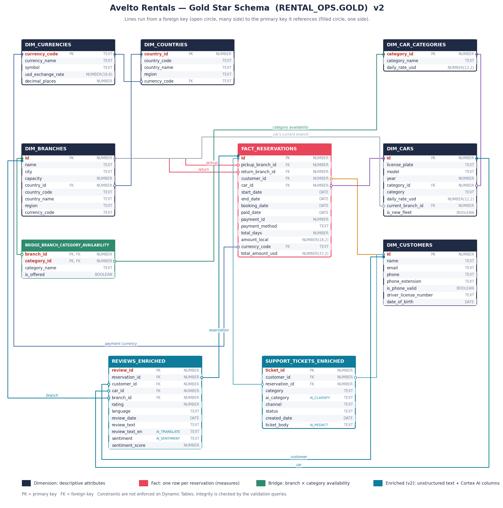

# Avelto Rentals — Gold Layer Star Schema

**Database / schema:** `RENTAL_OPS.GOLD`
**Object type:** Snowflake Dynamic Tables (`TARGET_LAG = '3 minutes'`, `REFRESH_MODE = INCREMENTAL`, warehouse `COMPUTE_WH`)
**Source code:**
- Structured data (star schema): `src/gold-layer-code/structured-data/01_gold_star_schema.sql`
- Unstructured data (AI-enriched): `src/gold-layer-code/semi-structured-data/01_support_tickets_enriched.sql`, `02_reviews_enriched.sql`

**Document version:** v2 — adds the unstructured-data tables `support_tickets_enriched` and `reviews_enriched` (see §9 Change log).

---

## 1. Business overview

Avelto Rentals is a car rental company operating **10 branches in 7 countries** across North America, Europe, Asia and Oceania. Two operational systems feed the data platform:

| Source system | What it provides |
|---|---|
| **FleetOps** | Master/reference data: branches, cars, car categories, customers, countries, currencies, and which car categories each branch offers |
| **BookWave** | Transactions: rental reservations with their payment |
| **Unstructured** (v2) | Free text: customer support tickets and customer reviews, enriched with Snowflake Cortex AI functions |

The Gold layer is the **analytics-ready star schema**: one fact table of reservations, surrounded by descriptive dimensions. It answers questions like:

- How much revenue (in USD) did each branch, country or region generate?
- Which car categories and models are rented most, and for how long?
- How many rentals are one-way (picked up at one branch, returned at another)?
- Which payment methods do customers use?
- Which branches offer which categories of car?
- *(v2)* Why are customers contacting support, and which tickets mention which reservations?
- *(v2)* How do customers feel about each branch, car and category, in any language?

### Data at a glance (current load)

| Metric | Value |
|---|---|
| Reservations | 2,000 |
| Rental start dates | 2023-08-12 → 2025-09-05 |
| Total revenue (USD) | $1,514,210.12 |
| Rental length | 1–14 days (avg 7.4) |
| One-way rentals | 1,818 of 2,000 (91%) |
| Customers / cars / car categories / branches | 500 / 210 / 6 / 10 |
| Support tickets *(v2)* | 300 (2023-08-20 → 2025-09-23), from 222 customers; 66 not linked to a reservation |
| Reviews *(v2)* | 1,400 (2023-08-17 → 2025-09-23), avg rating 3.69; 1,287 English, 113 translated (de 49, es 36, fr 28) |
| Review sentiment *(v2)* | positive 899 / negative 301 / mixed 172 / neutral 28 |

---

## 2. Architecture and data lineage

| Source file | Bronze (raw, as-is) | Silver (cleaned, 1 min lag) | Gold (star schema, 3 min lag) |
|---|---|---|---|
| `data/FleetOps/branches.csv` + `countries.csv` | `bronze_branches`, `bronze_countries` | `stg_fleetops_branches`, `stg_fleetops_countries` | `dim_branches` |
| `data/FleetOps/countries.csv` | `bronze_countries` | `stg_fleetops_countries` | `dim_countries` |
| `data/FleetOps/currencies.csv` | `bronze_currencies` | `stg_fleetops_currencies` | `dim_currencies` |
| `data/FleetOps/car_categories.csv` | `bronze_car_categories` | `stg_fleetops_car_categories` | `dim_car_categories` |
| `data/FleetOps/cars.csv` + `car_categories.csv` | `bronze_cars`, `bronze_car_categories` | `stg_fleetops_cars`, `stg_fleetops_car_categories` | `dim_cars` |
| `data/FleetOps/customers.csv` | `bronze_customers` | `stg_fleetops_customers` | `dim_customers` |
| `data/FleetOps/branch_category_availability.csv` | `bronze_branch_category_availability` | `stg_fleetops_branch_category_availability` | `bridge_branch_category_availability` |
| `data/BookWave/reservations_export.json` + `currencies.csv` | `bronze_bookwave_reservations_raw`, `bronze_currencies` | `stg_bookwave_reservations`, `stg_fleetops_currencies` | `fact_reservations` |
| `data/Unstructured/support_tickets.csv` *(v2)* | `bronze_support_tickets` | `support_tickets_enriched` (AI_CLASSIFY + AI_REDACT) | `support_tickets_enriched` |
| `data/Unstructured/reviews.csv` *(v2)* | `bronze_reviews` | `reviews_enriched` (AI_SENTIMENT + AI_TRANSLATE) | `reviews_enriched` |

- **Bronze**: data landed exactly as received (text columns, nested JSON in a VARIANT).
- **Silver**: typed, trimmed, standardised; data-quality issues exposed as `is_*` flag columns.
- **Gold**: business-friendly star schema built only from Silver.

- **Silver, unstructured data (v2)**: Cortex AI enrichment (classification, PII redaction, sentiment, translation). These are **plain tables, not Dynamic Tables**, so the AI functions run once per script run rather than on every refresh.

**Refresh behaviour.** Gold refreshes automatically within 3 minutes of a Silver change; Silver refreshes within 1 minute of a Bronze change. New data loaded into Bronze therefore reaches Gold in a few minutes with no manual step.
*Exception (v2):* the two unstructured Silver tables are plain tables. New tickets or reviews reach Gold only after the Silver script is rerun (this reruns the AI functions); Gold then refreshes within 3 minutes.

---

## 3. Entity-relationship diagram



*Current version: **v2**. Lines run from a foreign key (open circle, many side) to the primary key it references (filled circle, one side). `fact_reservations` connects to `dim_branches` twice: once as the pickup branch and once as the return branch.*

*The two teal tables at the bottom (v2) hold the unstructured data; columns tagged `AI_*` are produced by that Cortex AI function in Silver.*

> The image is generated by `render_er_diagram.py` in this folder.

#### Diagram versions

| Version | Image | Contents | Script |
|---|---|---|---|
| **v2 (current)** | `gold_star_schema_er_v2.png` | v1 + `support_tickets_enriched`, `reviews_enriched` | `render_er_diagram.py` |
| v1 (archived) | `er-diagram-archive/gold_star_schema_er_v1.png` | Structured star schema only (FleetOps + BookWave) | `er-diagram-archive/render_er_diagram_v1.py` |

**To make a new version after a schema change:** copy the current PNG and `render_er_diagram.py` into `er-diagram-archive/` with the `_v<N>` suffix, increase `VERSION` in `render_er_diagram.py`, update the `TABLES` list and links, run `python3 render_er_diagram.py`, and add a row to the table above. Never delete archived versions.

### Relationship summary

| From (child) | Column | To (parent) | Column | Cardinality | Business meaning |
|---|---|---|---|---|---|
| `fact_reservations` | `pickup_branch_id` | `dim_branches` | `id` | many → 1 | Branch where the car was collected (role-playing dimension) |
| `fact_reservations` | `return_branch_id` | `dim_branches` | `id` | many → 1 | Branch where the car was returned (role-playing dimension) |
| `fact_reservations` | `customer_id` | `dim_customers` | `id` | many → 1 | Customer who rented |
| `fact_reservations` | `car_id` | `dim_cars` | `id` | many → 1 | Car that was rented |
| `fact_reservations` | `currency_code` | `dim_currencies` | `currency_code` | many → 1 | Currency the customer paid in |
| `dim_branches` | `country_id` | `dim_countries` | `country_id` | many → 1 | Country the branch operates in |
| `dim_countries` | `currency_code` | `dim_currencies` | `currency_code` | many → 1 | Local currency of the country |
| `dim_cars` | `current_branch_id` | `dim_branches` | `id` | many → 1 | Where the car is parked **now** (not at rental time) |
| `bridge_branch_category_availability` | `branch_id` | `dim_branches` | `id` | many → 1 | Branch side of branch × category |
| `dim_cars` | `category_id` | `dim_car_categories` | `category_id` | many → 1 | Category the car belongs to |
| `support_tickets_enriched` *(v2)* | `customer_id` | `dim_customers` | `id` | many → 1 | Customer who raised the ticket |
| `support_tickets_enriched` *(v2)* | `reservation_id` | `fact_reservations` | `id` | many → 0..1 | Reservation the ticket is about (NULL for 66 tickets) |
| `reviews_enriched` *(v2)* | `reservation_id` | `fact_reservations` | `id` | many → 1 | Reservation being reviewed |
| `reviews_enriched` *(v2)* | `customer_id` | `dim_customers` | `id` | many → 1 | Reviewer |
| `reviews_enriched` *(v2)* | `car_id` | `dim_cars` | `id` | many → 1 | Car reviewed |
| `reviews_enriched` *(v2)* | `branch_id` | `dim_branches` | `id` | many → 1 | Branch reviewed (equals the reservation's pickup branch) |
| `bridge_branch_category_availability` | `category_id` | `dim_car_categories` | `category_id` | many → 1 | Category side of branch × category |

> Snowflake does not enforce PK/FK constraints on Dynamic Tables. Integrity is verified by the validation queries in the source script (current result: **0 orphan keys**, including the v2 tables).

---

## 4. Table reference

All columns are nullable at the database level; the "Nullable in practice" column shows whether nulls currently occur.

### 4.1 `fact_reservations` — Fact

| | |
|---|---|
| **Grain** | One row per rental reservation (each reservation has exactly one payment) |
| **Rows** | 2,000 |
| **Source** | `SILVER.stg_bookwave_reservations` + `SILVER.stg_fleetops_currencies` (exchange rate) |
| **Business description** | Every booking made through BookWave: who rented which car, from which branch to which branch, for which dates, and how much they paid. This is the main table for revenue and utilisation analysis. |

| # | Column | Data type | Key | Nullable in practice | Description |
|---|---|---|---|---|---|
| 1 | `id` | NUMBER(38,0) | PK | No | BookWave reservation identifier (`reservationId`). |
| 2 | `pickup_branch_id` | NUMBER(38,0) | FK → `dim_branches.id` | No | Branch where the rental starts. |
| 3 | `return_branch_id` | NUMBER(38,0) | FK → `dim_branches.id` | No | Branch where the car is returned. Differs from pickup for one-way rentals. |
| 4 | `customer_id` | NUMBER(38,0) | FK → `dim_customers.id` | No | Renting customer (BookWave `customerRef`). |
| 5 | `car_id` | NUMBER(38,0) | FK → `dim_cars.id` | No | Rented vehicle (BookWave `vehicleId`). |
| 6 | `start_date` | DATE | | No | First day of the rental. Converted from DD/MM/YYYY. |
| 7 | `end_date` | DATE | | No | Last day of the rental (return date). |
| 8 | `booking_date` | DATE | | No | Date the customer made the booking. |
| 9 | `paid_date` | DATE | | No | Date the payment was made. Can be after `start_date` (132 rentals). |
| 10 | `payment_id` | NUMBER(38,0) | | No | BookWave payment identifier. |
| 11 | `payment_method` | TEXT | | No | `Credit Card`, `Debit Card`, `Bank Transfer` or `PayPal`. |
| 12 | `total_days` | NUMBER(9,0) | Measure | No | Rental length in days = `end_date − start_date`. Range 1–14. |
| 13 | `amount_local` | NUMBER(18,2) | Measure | No | Amount paid, in the pickup branch's local currency. |
| 14 | `currency_code` | TEXT | FK → `dim_currencies.currency_code` | No | ISO currency of `amount_local`. Always equals the pickup branch's currency. |
| 15 | `total_amount_usd` | NUMBER(37,2) | Measure | No | `ROUND(amount_local × usd_exchange_rate, 2)`. Use this for cross-country totals. |

**Business rules and notes**
- Do **not** sum `amount_local` across currencies; use `total_amount_usd`.
- `total_amount_usd` ≈ `dim_cars.daily_rate_usd × total_days` (exact for 1,914 of 2,000 reservations, within 2% for all), confirming the conversion is consistent with the price list.
- To analyse by pickup **and** return location, join `dim_branches` twice with different aliases (see §6).

### 4.2 `dim_branches` — Dimension

| | |
|---|---|
| **Grain** | One row per rental branch |
| **Rows** | 10 |
| **Source** | `SILVER.stg_fleetops_branches` + `SILVER.stg_fleetops_countries` |
| **Business description** | The physical rental locations. Enriched with country, region and local currency so reports can roll up by geography without extra joins. Used twice by the fact table (pickup and return roles). |

| # | Column | Data type | Key | Description |
|---|---|---|---|---|
| 1 | `id` | NUMBER(38,0) | PK | Branch identifier. |
| 2 | `name` | TEXT | | Branch name. |
| 3 | `city` | TEXT | | City the branch is located in. |
| 4 | `capacity` | NUMBER(38,0) | | Maximum number of cars the branch can hold. |
| 5 | `country_id` | NUMBER(38,0) | FK → `dim_countries.country_id` | Country of the branch. |
| 6 | `country_code` | TEXT | | ISO 3166 alpha-2 code (denormalised). |
| 7 | `country_name` | TEXT | | Country name (denormalised). |
| 8 | `region` | TEXT | | North America, Europe, Asia or Oceania (denormalised). |
| 9 | `currency_code` | TEXT | | Local currency, derived through the country (denormalised). |

**Current branches**

| id | Name | City | Country |
|---|---|---|---|
| 1 | South Eric Branch | Austin | US |
| 2 | Jordanville Branch | Denver | US |
| 3 | West Kristinaside Branch | Toronto | CA |
| 4 | West Robinview Branch | Frankfurt | DE |
| 5 | Andersonshire Branch | Manchester | GB |
| 6 | Adamstad Branch | Munich | DE |
| 7 | Davidstad Branch | Lyon | FR |
| 8 | Juarezview Branch | Osaka | JP |
| 9 | North Valerie Branch | Brisbane | AU |
| 10 | Suttonburgh Branch | Charlotte | US |

### 4.3 `dim_cars` — Dimension

| | |
|---|---|
| **Grain** | One row per vehicle in the fleet |
| **Rows** | 210 (22 models, model years 2015–2026) |
| **Source** | `SILVER.stg_fleetops_cars` + `SILVER.stg_fleetops_car_categories` |
| **Business description** | The rental fleet, with each car's category and list price per day. |

| # | Column | Data type | Key | Description |
|---|---|---|---|---|
| 1 | `id` | NUMBER(38,0) | PK | Car identifier. |
| 2 | `license_plate` | TEXT | | Registration plate (unique, uppercase). |
| 3 | `model` | TEXT | | Make and model, e.g. `Ferrari 488`. |
| 4 | `year` | NUMBER(38,0) | | Model year. |
| 5 | `category_id` | NUMBER(38,0) | FK → `dim_car_categories.category_id` | Car category identifier. |
| 6 | `category` | TEXT | | Category name, denormalised from `dim_car_categories` for convenience. |
| 7 | `daily_rate_usd` | NUMBER(12,2) | | List price per rental day, denormalised from `dim_car_categories`. |
| 8 | `current_branch_id` | NUMBER(38,0) | FK → `dim_branches.id` | Branch where the car is located **today**. Not the branch at the time of a past rental — use the fact's branch columns for that. |
| 9 | `is_new_fleet` | BOOLEAN | | TRUE for the 10 Convertible pilot cars added in the fleet expansion. |

### 4.4 `dim_car_categories` — Dimension

| | |
|---|---|
| **Grain** | One row per car category |
| **Rows** | 6 |
| **Source** | `SILVER.stg_fleetops_car_categories` |
| **Business description** | The vehicle classes Avelto rents out and their list price per day. This is the single master list of categories: `dim_cars` and `bridge_branch_category_availability` both reference it, so categories can be analysed, filtered and priced consistently even if a category has no cars or is offered at no branch. |

| # | Column | Data type | Key | Description |
|---|---|---|---|---|
| 1 | `category_id` | NUMBER(38,0) | PK | Car category identifier. |
| 2 | `category_name` | TEXT | | Category name. |
| 3 | `daily_rate_usd` | NUMBER(12,2) | | List price per rental day. Currency assumed USD (not stated in source). |

| category_id | Category | Daily rate (USD) |
|---|---|---|
| 1 | Economy | 40.00 |
| 2 | Compact | 50.00 |
| 3 | SUV | 70.00 |
| 4 | Luxury | 120.00 |
| 5 | Sports | 200.00 |
| 6 | Convertible | 150.00 |

### 4.5 `dim_customers` — Dimension

| | |
|---|---|
| **Grain** | One row per customer |
| **Rows** | 500 |
| **Source** | `SILVER.stg_fleetops_customers` |
| **Business description** | People who rent cars. Contains personal data (PII) — restrict access accordingly. |

| # | Column | Data type | Key | Description |
|---|---|---|---|---|
| 1 | `id` | NUMBER(38,0) | PK | Customer identifier. |
| 2 | `name` | TEXT | | Full name. Not unique (2 customers share a name). |
| 3 | `email` | TEXT | | Email address, lowercase. Unique. |
| 4 | `phone` | TEXT | | Phone in E.164 format (`+1XXXXXXXXXX`), standardised from 10+ source formats. |
| 5 | `phone_extension` | TEXT | | Extension, if any (311 customers). |
| 6 | `is_phone_valid` | BOOLEAN | | FALSE for 92 numbers whose area code starts with 0 or 1 (invalid North American format). |
| 7 | `driver_license_number` | TEXT | | Driving licence number. Unique. |
| 8 | `date_of_birth` | DATE | | Date of birth. Use with `start_date` to derive age at rental. |

### 4.6 `dim_countries` — Reference dimension

| | |
|---|---|
| **Grain** | One row per country Avelto operates in |
| **Rows** | 7 |
| **Source** | `SILVER.stg_fleetops_countries` |
| **Business description** | Countries and their region and local currency. |

| # | Column | Data type | Key | Description |
|---|---|---|---|---|
| 1 | `country_id` | NUMBER(38,0) | PK | Country identifier. |
| 2 | `country_code` | TEXT | | ISO 3166 alpha-2 code. |
| 3 | `country_name` | TEXT | | Country name. |
| 4 | `region` | TEXT | | Geographic region. |
| 5 | `currency_code` | TEXT | FK → `dim_currencies.currency_code` | Local currency. |

| country_id | Code | Country | Region | Currency |
|---|---|---|---|---|
| 1 | US | United States | North America | USD |
| 2 | CA | Canada | North America | CAD |
| 3 | DE | Germany | Europe | EUR |
| 4 | GB | United Kingdom | Europe | GBP |
| 5 | FR | France | Europe | EUR |
| 6 | JP | Japan | Asia | JPY |
| 7 | AU | Australia | Oceania | AUD |

### 4.7 `dim_currencies` — Reference dimension

| | |
|---|---|
| **Grain** | One row per currency |
| **Rows** | 6 |
| **Source** | `SILVER.stg_fleetops_currencies` |
| **Business description** | Currencies customers pay in, with the rate used to convert to USD. |

| # | Column | Data type | Key | Description |
|---|---|---|---|---|
| 1 | `currency_code` | TEXT | PK | ISO 4217 code. |
| 2 | `currency_name` | TEXT | | Currency name. |
| 3 | `symbol` | TEXT | | Display symbol. |
| 4 | `usd_exchange_rate` | NUMBER(18,6) | | USD value of 1 unit of this currency. |
| 5 | `decimal_places` | NUMBER(38,0) | | Minor-unit decimals (JPY = 0, others = 2). |

| Code | Name | Symbol | USD rate |
|---|---|---|---|
| USD | US Dollar | $ | 1.000000 |
| CAD | Canadian Dollar | CA$ | 0.720000 |
| EUR | Euro | € | 1.080000 |
| GBP | British Pound | £ | 1.270000 |
| JPY | Japanese Yen | ¥ | 0.006700 |
| AUD | Australian Dollar | A$ | 0.650000 |

> **Important:** exchange rates are a single, undated snapshot. Historical reservations are converted at today's rate, so USD totals are approximate for past periods.

### 4.8 `bridge_branch_category_availability` — Bridge

| | |
|---|---|
| **Grain** | One row per branch × car category (10 × 6 = 60) |
| **Rows** | 60 (53 offered, 7 not offered) |
| **Source** | `SILVER.stg_fleetops_branch_category_availability` |
| **Business description** | Resolves the many-to-many relationship between branches and car categories: which categories each branch is allowed to rent out. |

| # | Column | Data type | Key | Description |
|---|---|---|---|---|
| 1 | `branch_id` | NUMBER(38,0) | PK, FK → `dim_branches.id` | Branch. |
| 2 | `category_id` | NUMBER(38,0) | PK, FK → `dim_car_categories.category_id` | Car category. |
| 3 | `category_name` | TEXT | | Category name (denormalised from `dim_car_categories`). |
| 4 | `is_offered` | BOOLEAN | | TRUE if the branch offers this category. |

Currently every category is offered everywhere, except **Convertible**, which is offered only at branches 5 (Manchester), 6 (Munich) and 9 (Brisbane).

### 4.9 `support_tickets_enriched` — Enriched fact *(v2)*

| | |
|---|---|
| **Grain** | One row per customer support ticket |
| **Rows** | 300 |
| **Source** | `SILVER.support_tickets_enriched` ← `BRONZE.bronze_support_tickets` ← `data/Unstructured/support_tickets.csv` |
| **Business description** | Every support ticket with an AI-assigned category and a **PII-redacted** ticket text. The raw text (which contains names, phone numbers and emails) is not carried beyond Bronze. |

| # | Column | Data type | Key | Description |
|---|---|---|---|---|
| 1 | `ticket_id` | NUMBER(38,0) | PK | Ticket identifier. |
| 2 | `customer_id` | NUMBER(38,0) | FK → `dim_customers.id` | Customer who raised the ticket. |
| 3 | `reservation_id` | NUMBER(38,0) | FK → `fact_reservations.id` | Reservation the ticket refers to. NULL for 66 tickets (the text says "reservation #N/A"). |
| 4 | `category` | TEXT | | Category assigned by the source support system. |
| 5 | `ai_category` | TEXT | | Category from `AI_CLASSIFY` on the raw ticket text. One of: Billing Question, Vehicle Issue, General Feedback, Roadside Assistance, Damage Claim, Account Access, Refund Request, Booking Change. |
| 6 | `channel` | TEXT | | `Email`, `Phone` or `Chat`. |
| 7 | `status` | TEXT | | `Open`, `In Progress`, `Escalated` or `Resolved`. |
| 8 | `created_date` | DATE | | Date the ticket was opened. |
| 9 | `ticket_body` | TEXT | | Ticket text with names, phone numbers and emails replaced by `[NAME]`, `[PHONE_NUMBER]`, `[EMAIL]` (`AI_REDACT`). |

**Business rules and notes**
- `ai_category` agrees with `category` for 283 of 300 tickets (94%). All 17 differences are "charged twice, please refund" tickets: the source says *Billing Question*, the AI says *Refund Request*.
- Reservation numbers, car models and branch names are not personal data and are kept in `ticket_body`.

### 4.10 `reviews_enriched` — Enriched fact *(v2)*

| | |
|---|---|
| **Grain** | One row per customer review |
| **Rows** | 1,400 |
| **Source** | `SILVER.reviews_enriched` ← `BRONZE.bronze_reviews` ← `data/Unstructured/reviews.csv` |
| **Business description** | Customer reviews with an AI sentiment label and an English version of every review, so reviews can be analysed across languages alongside reservations, cars and branches. |

| # | Column | Data type | Key | Description |
|---|---|---|---|---|
| 1 | `review_id` | NUMBER(38,0) | PK | Review identifier. |
| 2 | `reservation_id` | NUMBER(38,0) | FK → `fact_reservations.id` | Reservation reviewed. |
| 3 | `customer_id` | NUMBER(38,0) | FK → `dim_customers.id` | Reviewer. Matches the reservation's customer. |
| 4 | `car_id` | NUMBER(38,0) | FK → `dim_cars.id` | Car reviewed. Matches the reservation's car. |
| 5 | `branch_id` | NUMBER(38,0) | FK → `dim_branches.id` | Branch reviewed. Matches the reservation's pickup branch. |
| 6 | `rating` | NUMBER(38,0) | Measure | Star rating, 1–5. |
| 7 | `language` | TEXT | | Language of the original text: `en`, `de`, `es`, `fr`. |
| 8 | `review_date` | DATE | | Date of the review. |
| 9 | `review_text` | TEXT | | Review as written, in the original language. |
| 10 | `review_text_en` | TEXT | | English text: `AI_TRANSLATE` output for non-English reviews, the original text for English ones. |
| 11 | `sentiment` | TEXT | | Overall sentiment from `AI_SENTIMENT` on the **original** text: `positive`, `negative`, `neutral` or `mixed`. |
| 12 | `sentiment_score` | NUMBER(1,0) | Measure | Numeric version of `sentiment`: positive = 1, negative = −1, otherwise 0. |

**Business rules and notes**
- Sentiment is scored on the original text, not the translation, because the translation sometimes changes details (see §7).
- Use the ID columns, not names in `review_text_en`, for branch and car analysis: translations sometimes alter branch names.

---

## 5. Glossary

| Term | Meaning |
|---|---|
| Reservation | A booking of one car by one customer for a date range, paid with one payment. |
| Pickup branch | Branch where the customer collects the car. |
| Return branch | Branch where the customer returns the car. |
| One-way rental | Pickup branch ≠ return branch. |
| Local amount | What the customer paid, in the pickup branch's currency. |
| USD amount | Local amount converted at `dim_currencies.usd_exchange_rate`. |
| New fleet | The Convertible pilot cars (ids 201–210) added in the fleet expansion. |
| Role-playing dimension | One dimension used for more than one role; here `dim_branches` as pickup and return. |
| AI category *(v2)* | Ticket category assigned by the Cortex `AI_CLASSIFY` function from the ticket text. |
| Redacted text *(v2)* | Text with personal data replaced by placeholders by Cortex `AI_REDACT`. |
| Sentiment *(v2)* | Overall tone of a review (positive / negative / neutral / mixed) from Cortex `AI_SENTIMENT`. |

---

## 6. Example queries

**Revenue by pickup country**
```sql
SELECT pb.country_name, COUNT(*) AS reservations, SUM(f.total_amount_usd) AS revenue_usd
FROM RENTAL_OPS.GOLD.fact_reservations f
JOIN RENTAL_OPS.GOLD.dim_branches pb ON pb.id = f.pickup_branch_id
GROUP BY 1 ORDER BY revenue_usd DESC;
```

**One-way rental routes (role-playing join)**
```sql
SELECT pb.city AS pickup_city, rb.city AS return_city, COUNT(*) AS rentals
FROM RENTAL_OPS.GOLD.fact_reservations f
JOIN RENTAL_OPS.GOLD.dim_branches pb ON pb.id = f.pickup_branch_id
JOIN RENTAL_OPS.GOLD.dim_branches rb ON rb.id = f.return_branch_id
WHERE f.pickup_branch_id <> f.return_branch_id
GROUP BY 1, 2 ORDER BY rentals DESC;
```

**Revenue and average rental length by car category**
```sql
SELECT k.category_name, k.daily_rate_usd, COUNT(f.id) AS rentals, AVG(f.total_days) AS avg_days, SUM(f.total_amount_usd) AS revenue_usd
FROM RENTAL_OPS.GOLD.dim_car_categories k
LEFT JOIN RENTAL_OPS.GOLD.dim_cars c          ON c.category_id = k.category_id
LEFT JOIN RENTAL_OPS.GOLD.fact_reservations f ON f.car_id = c.id
GROUP BY 1, 2 ORDER BY revenue_usd DESC NULLS LAST;
```

**Categories offered at each branch**
```sql
SELECT b.name, LISTAGG(a.category_name, ', ') WITHIN GROUP (ORDER BY a.category_id) AS categories_offered
FROM RENTAL_OPS.GOLD.bridge_branch_category_availability a
JOIN RENTAL_OPS.GOLD.dim_branches b ON b.id = a.branch_id
WHERE a.is_offered
GROUP BY 1;
```

**Support tickets by AI category and status** *(v2)*
```sql
SELECT ai_category, status, COUNT(*) AS tickets
FROM RENTAL_OPS.GOLD.support_tickets_enriched
GROUP BY 1, 2 ORDER BY 1, 2;
```

**Average rating and sentiment by branch** *(v2)*
```sql
SELECT b.name, COUNT(*) AS reviews, AVG(r.rating) AS avg_rating, AVG(r.sentiment_score) AS avg_sentiment
FROM RENTAL_OPS.GOLD.reviews_enriched r
JOIN RENTAL_OPS.GOLD.dim_branches b ON b.id = r.branch_id
GROUP BY 1 ORDER BY avg_sentiment;
```

**Reviews whose stars contradict their text** *(v2)*
```sql
SELECT review_id, language, rating, sentiment, review_text_en
FROM RENTAL_OPS.GOLD.reviews_enriched
WHERE (rating >= 4 AND sentiment = 'negative') OR (rating <= 2 AND sentiment = 'positive');
```

---

## 7. Data quality and known limitations

| # | Item | Impact | Status |
|---|---|---|---|
| 1 | Exchange rates are an undated snapshot | Historical USD amounts use today's rate | Open: needs dated rates for accurate history |
| 2 | `vehicleId` → `cars.id` mapping is unconfirmed | Same car can appear in overlapping bookings (163 cases); car location history doesn't line up | Open: confirm with BookWave team |
| 3 | `daily_rate_usd` currency not stated in source | Assumed USD | Open: confirm with FleetOps |
| 4 | 92 customer phone numbers invalid | Flagged via `is_phone_valid = FALSE` | Known; kept, not dropped |
| 5 | 2 customers share a name | Different emails and licences, likely different people | Known |
| 6 | `dim_cars.current_branch_id` is a current snapshot | Not suitable for historical location analysis | By design |
| 7 | 132 payments dated after rental start | May be pay-at-pickup | Open: confirm business rule |
| 8 | 91% of rentals are one-way | Unusually high | Open: confirm with business |
| 9 | No reservations for new-fleet Convertibles | Pilot cars not yet rented | Informational |
| 10 | *(v2)* 35 reviews have star ratings that contradict their text (e.g. 5★ for "not properly cleaned"); all are non-English | Ratings for de/es/fr reviews are unreliable; sentiment looks correct | Open: confirm with the source of the review data |
| 11 | *(v2)* `AI_TRANSLATE` sometimes alters details: branch names (West Kristinaside → "West Kristiansand", Davidstad → "Davidstow"), added words ("Convertible") | `review_text_en` is for reading, not for matching names | Known; use ID columns; original text kept |
| 12 | *(v2)* `ai_category` vs source `category`: 17 duplicate-charge tickets differ (Billing Question vs Refund Request) | Category counts differ depending on which column is used | Open: agree on a convention; can be tuned with category descriptions in `AI_CLASSIFY` |
| 13 | *(v2)* `AI_REDACT` is best-effort | Leftover personal data is possible | Checked: 0 leftover emails (regex); phones and names checked by sample only |
| 14 | *(v2)* 66 tickets have no reservation | Cannot be joined to `fact_reservations` | Known; `reservation_id` is NULL |
| 15 | *(v2)* Unstructured Silver tables are not Dynamic Tables | New tickets or reviews need a manual Silver rerun (incurs AI cost) | By design (cost control) |

---

## 8. Operations

| Item | Value |
|---|---|
| Refresh | Automatic, Dynamic Tables, target lag 3 minutes (Silver: 1 minute) |
| Refresh mode | INCREMENTAL (only changed rows are processed) |
| Warehouse | `COMPUTE_WH` |
| Deploy / rebuild (structured) | Run `src/gold-layer-code/structured-data/01_gold_star_schema.sql` (idempotent `CREATE OR ALTER`) |
| Deploy / rebuild (unstructured, v2) | Run, in order: `src/bronze-layer-code/semi-structured-data/0N_*.sql` → `src/silver-layer-code/semi-structured-data/0N_*.sql` → `src/gold-layer-code/semi-structured-data/0N_*.sql` (`01_` = support tickets, `02_` = reviews). Rerunnable; the Silver step reruns the AI functions (~300 tickets, ~1,400 reviews). |
| Validation | Validation section at the end of the same script: row counts, orphan keys, null measures, USD totals by currency |
| Health check | `SHOW DYNAMIC TABLES IN SCHEMA RENTAL_OPS.GOLD;` — expect `ACTIVE` and `INCREMENTAL` |

**Current validation status (all passing):** fact 2,000 rows; dims branches 10 / cars 210 / customers 500 / countries 7 / currencies 6 / car categories 6; bridge 60; 0 orphan foreign keys; 0 null measures; 100% of time within target lag.

**v2 validation status (all passing):** support tickets Bronze / Silver / Gold = 300 / 300 / 300; reviews = 1,400 / 1,400 / 1,400; unique IDs, none missing; 0 failed type conversions; 0 orphan foreign keys; reviews' customer, car and branch match their reservation; 0 NULL AI outputs.

---

## 9. Change log

| Version | Date | Changes |
|---|---|---|
| v1 | — | Gold star schema for structured data (FleetOps + BookWave): 1 fact, 6 dimensions, 1 bridge. |
| v2 | 2026-11-11 | Added unstructured data: `support_tickets_enriched` (AI_CLASSIFY, AI_REDACT) and `reviews_enriched` (AI_SENTIMENT, AI_TRANSLATE) through Bronze → Silver → Gold. New ER diagram v2 (v1 archived in `er-diagram-archive/`). Source-code paths updated to the `structured-data/` and `semi-structured-data/` folders. `ticket_body` cast from VARIANT to TEXT. |
